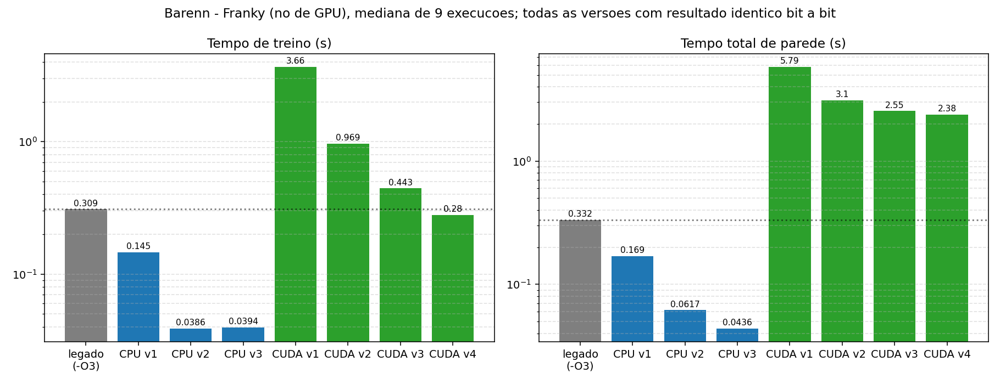
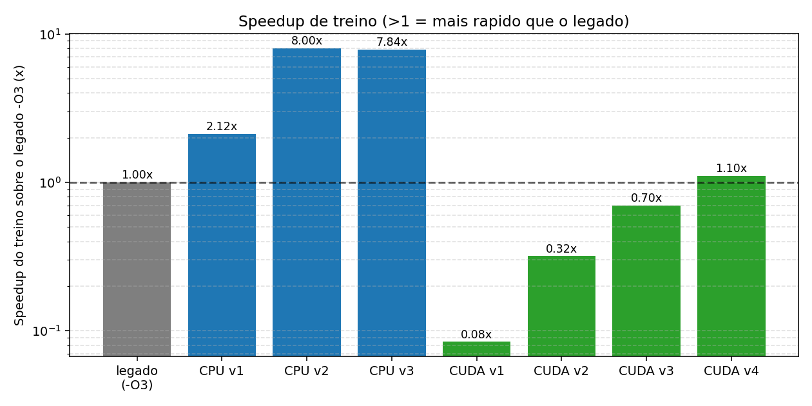
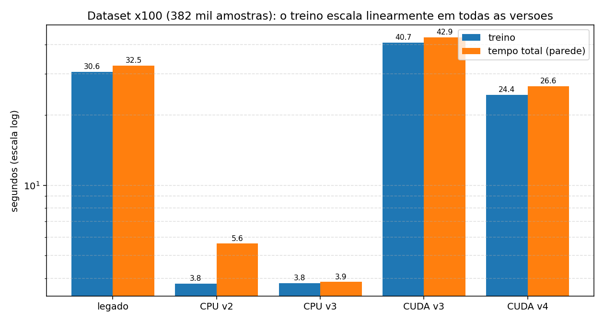
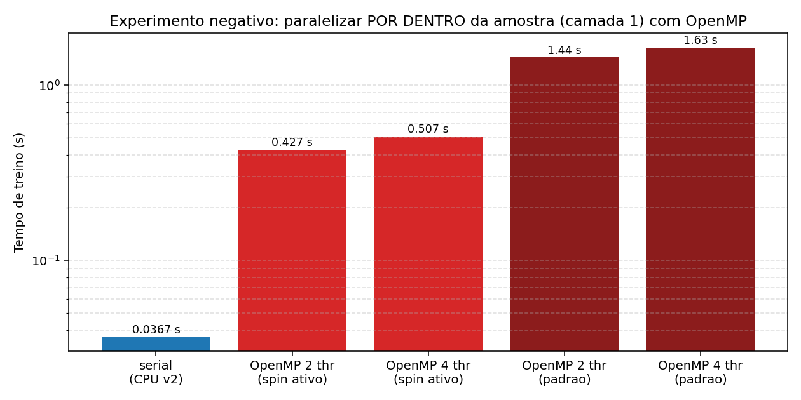
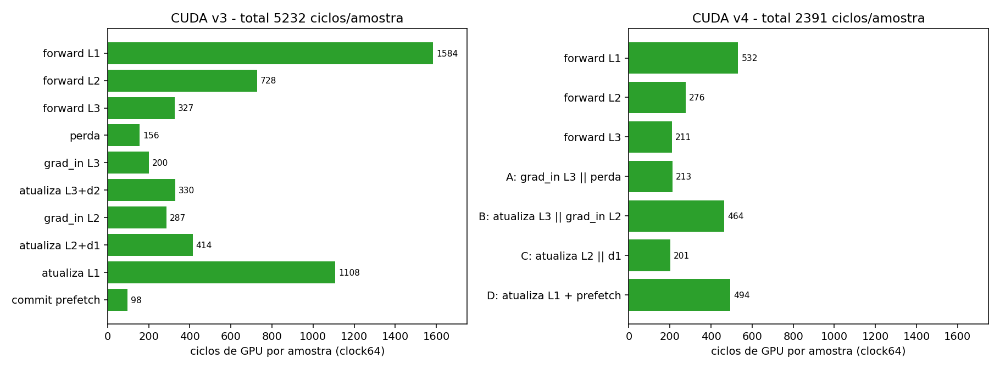

# Resultados e metodologia

Os números vêm de `docs/evidencias/` (saídas brutas) e podem ser regerados com `scripts/bench.sh` / `scripts/comparar.sh`. Gráficos: `python3 docs/gerar_graficos.py`.

## 1. Metodologia

- **Corretude primeiro.** Toda versão imprime `HASH_PESOS` e `HASH_PERDAS` (FNV-1a sobre os bits dos pesos finais e das perdas por época, `BARENN_HASH=1`). Referência do legado: `HASH_PESOS 366b333cd5264116`, `HASH_PERDAS 0b1dad0f07974985` (`ref/`). No dataset x100: `cd782a2c8237fa54` / `bea1bb97fdb3134a`. Nenhum tempo é reportado sem hash idêntico.
- **Política numérica.** A ordem da soma por neurônio é preservada (vetoriza-se *entre* neurônios, nunca se reassocia a soma). `-ffp-contract=off`, sem `-ffast-math`; na GPU `--fmad=false`. FMA muda o hash (`24d050fe…`), mesmo com acurácia impressa igual (95,5 %).
- **Medição.** Sempre `srun --exclusive --ntasks=1`; 9 repetições, mediana. Versões comparadas na **mesma alocação** (`scripts/comparar.sh`), pois a variação entre nós/clock é ~10 % (clock da GPU oscila 1462 ↔ 2100 MHz).
- **Treino** = só o laço de épocas; **wall** = processo inteiro (leitura, avaliação e, na GPU, ≈1,7–1,9 s de inicialização do contexto CUDA).
- Compilação só no nó de login (nós de computação sem headers/valgrind).

## 2. Ambientes

| Item | CPU | GPU |
|---|---|---|
| Cluster | Franky (SLURM), fila `sunny_cpu` | Franky, fila `sunny_gpu` (`--gres=gpu:1`) |
| Nó | compute10, i7-13700 (8 CPUs alocadas) | compute20, i9-14900 + NVIDIA RTX A1000 (sm_86, 18 SMs) |
| Compilador | GCC 14.2.0 | GCC 14.2.0 + nvcc 12.8.93 |
| Profiling | callgrind (`--cache-sim=yes`) | nsys 2025.3.1, `cudaFuncGetAttributes`, `cudaOccupancy*`, `clock64()` |

## 3. Tabela consolidada (nó de CPU, mediana de 9)

| Versão | Treino (s) | Wall (s) | Speedup | Hash |
|---|---|---|---|---|
| Baseline legado (`-O3`) | 0,3543 | 0,3801 | 1,00× | referência |
| CPU v1 (sem trabalho morto/alocações) | 0,1693 | 0,1950 | 2,09× | OK |
| CPU v2 (SIMD entre neurônios) | 0,0367 | 0,0613 | 9,65× | OK |
| **CPU Otimizada (v3, OpenMP onde é exato)** | 0,0382 | 0,0410 | 9,27× (wall) | OK |

Legado em outros níveis: `-O0` 5,1909 s; `-O2` 0,4608 s; `-O3 -march=x86-64-v3 -ffp-contract=off` 0,4007 s (pior).

## 4. Tabela consolidada (nó de GPU, mediana de 9)

| Versão | Treino (s) | Wall (s) | vs legado (treino) | Hash |
|---|---|---|---|---|
| Baseline legado | 0,3088 | 0,3319 | 1,00× | referência |
| CPU v1 | 0,1455 | 0,1686 | 2,12× | OK |
| CPU v2 | 0,0386 | 0,0617 | 8,0× | OK |
| CPU v3 | 0,0394 | 0,0436 | 7,8× | OK |
| **CUDA Inicial (v1)** | 3,6614 | 5,7878 | 11,9× **mais lento** | OK |
| CUDA v2 (kernel fundido) | 0,9687 | 3,0973 | 3,1× mais lento | OK |
| CUDA v3 (persistente) | 0,4434 | 2,5464 | 1,4× mais lento | OK |
| **CUDA Otimizado (v4)** | 0,2798 | 2,3810 | 1,10× mais rápido | OK |

## 5. Escala (x100: 382.300 treino / 179.700 teste)

| Versão | Treino (s) | Wall (s) |
|---|---|---|
| Legado | 30,57 | 32,51 |
| CPU v2 | 3,79 | 5,62 |
| CPU v3 | 3,81 | 3,86 |
| CUDA v3 | 40,74 | 42,93 |
| CUDA v4 | 24,40 | 26,56 |

Leitura (x100): legado 2220,7 ms; v3 com T=1/2/4/8/16 = 109,5 / 64,6 / 46,1 / 36,2 / 39,3 ms. Avaliação: 13,3 / 7,9 / 5,3 / 4,0 / 4,0 ms.

## 6. Análise técnica

### 6.1 CPU: gargalo é instrução, não memória
Callgrind no legado (`-O2 -g`, 14,03 G Ir): `Backward` 67,4 %, `main` 23,8 %; cache miss de leitura 0,04 % (2.720 pesos = 10,9 KB cabem na L1). 75 % do laço de `grad_in` era trabalho morto (o gradiente da camada 1 é descartado). v1: 3,35 G Ir. v2: 1,315 G Ir; passo por amostra de 42,7 k para 4,46 k instruções, ≈ 79 GFLOP/s em um núcleo (14.944 FLOP × 194.973 passos / 0,0367 s). O teto exato do núcleo não foi medido, então não há percentual do pico.

### 6.2 Amdahl no treino
O SGD amostra-a-amostra é uma cadeia de dependência. Só leitura e avaliação são paralelizáveis sem mudar o resultado (carga 22,3 → 0,6 ms). O treino, 93 % do wall (0,0382 de 0,0410 s), é serial; mini-batch/Hogwild mudariam algoritmo e hash, então ficam como trabalho futuro.

OpenMP *dentro* da amostra: 12× a 39× mais lento em três rodadas (serial 0,0367 s; 2 threads 0,4268 s com espera ativa, 1,4352 s e 0,865 s com a política padrão; região paralela vazia de 0,42 a 12,0 µs conforme threads e política, contra 0,19 µs de trabalho por amostra).

### 6.3 GPU: latência, não banda
~15 k FLOP por amostra e 15 k+ passos sequenciais: o custo é latência por passo.

- **v1:** 10 kernels por amostra. nsys: `cudaLaunchKernel` 38.230 chamadas, média 2.567 ns; kernels de 1,2–2,9 µs; piso de `k_avancar` 1,24 µs. CUDA Graph na v1 dá só 1,37× (3,6577 → 2,6753 s).
- **v2:** 1 kernel fundido por amostra (shared + `__syncthreads`).
- **v3:** kernel persistente, pesos em shared, prefetch, avaliação em stream separada.
- **v4:** ablação: v3 0,4411 → 0,3225 → 0,3164 (`__launch_bounds__(T,1)`) → 0,2781 s (carregar tudo, calcular, armazenar, com barreira de compilador). Threads/bloco: 64: 0,2801; 128: 0,2783; 256: 0,2896; 512: 0,3218. `clock64()`: 5232 → 2391 ciclos/amostra. 92 registradores, 0 spill. ≈ 10,4 GFLOP/s ≈ 0,31 % do pico não-FMA (3,37 TFLOP/s).

### 6.4 PCIe
No v4 o H2D pinned do teste (39,8 µs) sobrepõe-se ao kernel de treino (268,9 ms): irrelevante. A inicialização do contexto CUDA (~1,8 s) domina o wall em dataset pequeno.

### 6.5 Conclusão
Com treino fiel e sequencial, a GPU fica 1,10× acima do legado e 7,2× abaixo da CPU v2; no x100, CPU v3 é 6,4× mais rápida que CUDA v4. Ganho real em GPU exigiria mudar o algoritmo.

## 7. Limitações

- Nsight Compute indisponível no Franky (`ERR_NVGPUCTRPERM`); substituído por nsys, atributos de kernel, ocupância e `clock64()`.
- Uma única GPU (RTX A1000).
- Santos Dumont não executado (VPN indisponível). O Makefile suporta `ARCH=sm_70` e `ISA=-mavx2`.
- Variação entre nós ~10 %; comparações sempre na mesma alocação.
